# TabSis — manual do usuário

Este manual descreve o que o programa **faz hoje**. Onde algo não é suportado,
está dito que não é. Onde uma escolha existe mas não é óbvia, está dito qual é
o padrão — porque um padrão invisível é uma armadilha, não uma conveniência.

---

## 1. O que é, em uma página

O TabSis tabula microdados públicos do DATASUS no navegador, seguindo a
semântica do **TabWin 4.15** do próprio DATASUS. Ele lê os arquivos que você já
usa: `.DBC`, `.DBF`, `.CSV`, o formato leve `.parquet` do próprio TabSis, e os
metadados legados `.DEF`, `.CNV` e `.MAP`. O guia
[dos arquivos](./GUIA_ARQUIVOS_DATASUS.md) explica cada um.

**Seus dados não saem do seu aparelho.** A leitura e o cálculo acontecem no
navegador. Quando você busca no catálogo oficial, o que trafega é o download do
DATASUS para você — nunca os seus resultados para algum servidor. A tarja
"Seus dados ficam neste aparelho" no topo da tela não é slogan; é a descrição
do funcionamento.

**Não precisa instalar nada** e não precisa de internet depois que o arquivo
está aberto.

### Quando ele *não* é a ferramenta certa

- Se você precisa de compatibilidade byte a byte com um recurso do TabWin 4.15
  que ainda não foi verificado contra o programa real. A seção 12 explica como
  saber quais são.
- Se o arquivo é maior do que a memória do aparelho aguenta. **Tabular** lê em
  blocos e não tem essa parede; quem tem é **Extrair DBF original**, que
  precisa do arquivo inteiro de uma vez. Nesse caso o programa avisa **antes**
  de tentar, dizendo de quantos MiB precisaria, e deixa explícito que o arquivo
  **não** foi tratado como corrompido e que nada já aberto foi alterado.

---

## 2. Primeiro uso

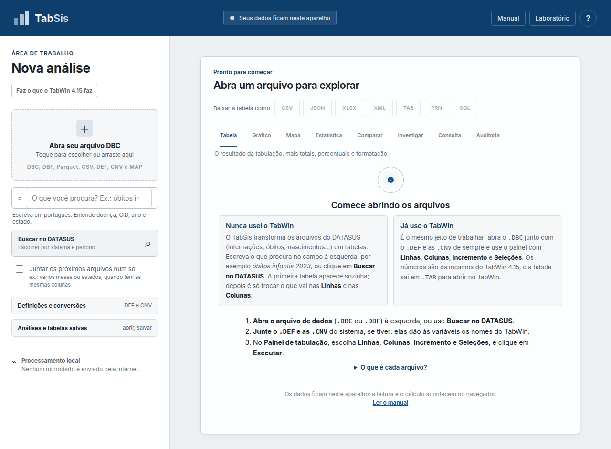

A tela inicial tem dois caminhos, e os dois chegam à mesma tabela.

**Nunca usei o TabWin.** O TabSis transforma os arquivos do DATASUS
(internações, óbitos, nascimentos…) em tabelas.

1. Escreva o que procura no campo à esquerda — *óbitos infantis 2023* — ou
   clique em **Buscar no DATASUS** (seção 3).
2. **A primeira tabela aparece sozinha**, para você ver que o arquivo abriu e
   que os números fazem sentido.
3. Troque o que vai nas **Linhas** e nas **Colunas** do Painel de tabulação e
   clique em **Executar** (seção 4). Cada bloco e cada opção do painel tem uma
   frase curta dizendo o que faz.

**Já uso o TabWin.** É o mesmo jeito de trabalhar: abra o `.DBC` junto com o
`.DEF` e as `.CNV` de sempre (pode selecionar a pasta inteira de uma vez) e use
o painel com **Linhas**, **Colunas**, **Incremento** e **Seleções**. Os nomes
são os do DEF, na ordem do DEF; os números são os mesmos do TabWin 4.15; e a
tabela sai em `.TAB` para abrir no TabWin.

Em qualquer dos dois, os arquivos aparecem na barra lateral pelo **nome
original** — é por ele que as pessoas se entendem — e, logo embaixo, o que cada
um é: `DOINF23.dbc` → *Óbitos infantis · SIM · Brasil · 2023*.

---

## 3. Buscar dados no DATASUS

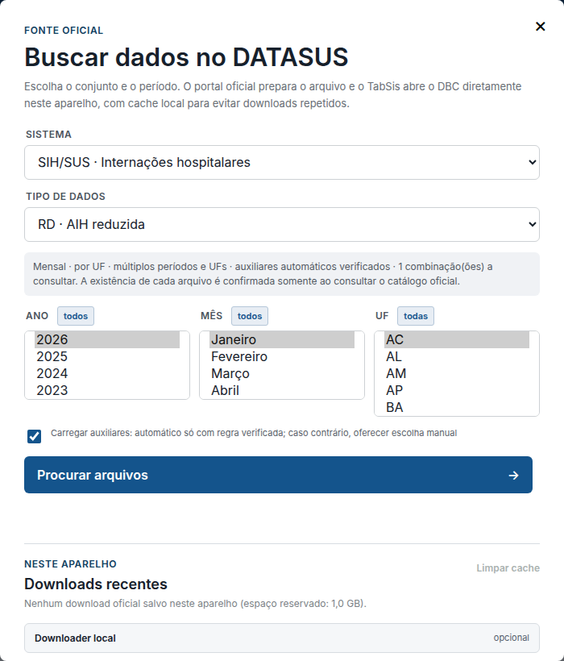

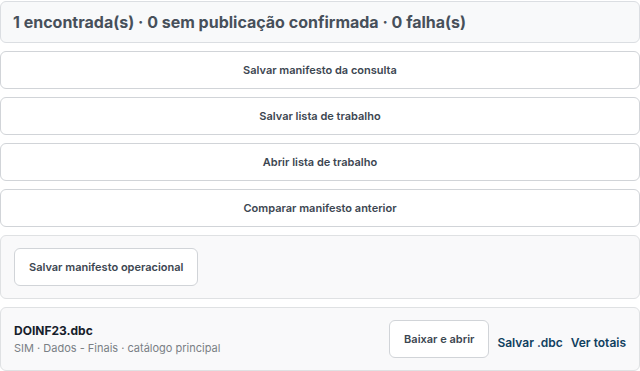

**Buscar no DATASUS** abre o catálogo oficial. Você escolhe sistema (SINAN,
SIM, SINASC, SIH, CNES…), tipo de dado, e ano ou período.

Alguns pontos que economizam tempo:

- **Vários anos de uma vez.** Segure Ctrl (ou Cmd) para selecionar mais de um,
  ou clique em **todos** ao lado do rótulo — o mesmo vale para mês e UF. O
  botão vira **limpar** quando tudo já está marcado, então ele nunca mente
  sobre o que o próximo clique faz.
- **Arquivo nacional × por UF.** Alguns sistemas publicam um arquivo único do
  Brasil; nesses, a UF se escolhe *depois*, no filtro, e não na busca. Em
  SINAN, atenção: existe UF de residência **e** UF de notificação, e são coisas
  diferentes.
- **Quando existem as duas formas** (SINASC/DN e SIM/DO), marcar três UFs ou
  mais faz aparecer um aviso com o botão **Usar o arquivo nacional**: são
  aproximadamente os mesmos dados em um download por período em vez de um por
  UF. Escolher por UF continua legítimo — o arquivo estadual é bem menor, e
  quem só quer uma UF não deve baixar o país.
- **Seleções muito grandes pedem confirmação.** Acima de 200 combinações o
  programa mostra o tamanho e o tempo estimado *só da consulta* antes de
  começar; o download vem depois e demora bem mais. Recusar não faz nada: dá
  para reduzir anos, meses ou UFs e pedir de novo.
- **A existência do arquivo só é confirmada ao consultar.** O programa não
  adivinha se um período existe; ele pergunta ao catálogo.
- **Salvar manifesto da consulta** grava o que foi pedido e o que foi
  encontrado. **Comparar manifesto anterior** mostra o que apareceu ou sumiu
  desde a última vez — útil para acompanhar publicação de dados preliminares.

### Salvar um arquivo sem abrir

Cada resultado tem **Salvar .dbc** ao lado de **Baixar e abrir**. Ele grava o
arquivo no seu computador e para por aí — não monta tabulação nenhuma. É o
caminho de quem vai usar o dado no R, no Python ou em outra máquina, e num
arquivo de mais de 100 MB é justamente a etapa de abrir que pesa. Sai o
`.dbc` de dentro do pacote, não o `.zip` como veio da rede.

### Baixar em lote, e empacotar

Com mais de um resultado aparece uma barra com uma **caixa por arquivo**
(todas marcadas) e duas ações, que agem sobre **o que estiver escolhido** —
e há um **selecionar todos** para quem quer a lista inteira num clique:

- **Baixar e combinar** — abre os arquivos e monta um conjunto único. O
  primeiro sucesso inicia o conjunto; os demais só entram se o esquema for
  compatível.
- **Baixar e empacotar .zip** — baixa e entrega um pacote para você guardar,
  **sem abrir nem combinar**. Serve para levar os dados ao R, ao Python ou a
  outra máquina. Dentro vai um `MANIFESTO.json` com origem, tamanho, hash e
  hora de obtenção de cada arquivo: um pacote de microdados sem procedência
  vira problema na hora de citar.

Com nada marcado as duas ficam indisponíveis, em vez de rodarem vazias.

### Baixar o que já está guardado

Em **Downloads recentes**, cada pacote guardado neste aparelho tem **Baixar**
ao lado de **Abrir offline**. Querer o arquivo é diferente de querer analisá-lo
aqui: o botão grava o `.dbc` em disco **sem abrir a análise**, para você levar
o dado a outro programa. Com mais de um guardado, aparece **Baixar tudo
(.zip)** no topo da lista.

Sai o arquivo que você reconhece — o `.dbc` de dentro do pacote —, não o
`.zip` como veio da rede. Quando um pacote traz mais de um arquivo, sai um
`.zip`, porque juntar arquivos distintos num nome só seria mentira.

Em ambas, **uma falha não derruba o lote**: o que falhou é nomeado e você
pode **retentar somente as falhas**, sem baixar tudo de novo. Os `.dbc`
entram no pacote sem recompressão, porque já são comprimidos.

### Arquivos auxiliares (DEF e CNV)

Os `.DEF` e `.CNV` são o que transforma código em nome legível: `1` vira
`Masculino`, `A519` vira o capítulo da CID-10.

- Quando a associação entre o dado e o pacote auxiliar **foi verificada contra
  um caso real**, o programa carrega sozinho.
- Quando **não foi**, ele mostra os pacotes e você escolhe. Ele não infere pelo
  nome. Isso é deliberado: parecer certo não é ser certo.
- **Abrir todos** carrega de uma vez todos os DEF e CNV do pacote. Se algum
  arquivo falhar, os outros continuam, e o resultado diz quantos entraram e
  quantos não.
- O mesmo vale quando você seleciona a pasta de CNV inteira na área "Abra seu
  arquivo": um arquivo com defeito (a `MUNICDF.CNV` do SIM, que nem o TabWin
  abre) é nomeado num aviso, e os outros entram.

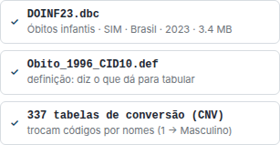

Uma opção do DEF que o TabWin lista mas não é variável — as linhas-título como
`* DADOS GERAIS *` dos DEFs do CNES — aparece em cinza, com a explicação.

Se um arquivo do pacote for grande demais para caber na memória da aba junto
com os dados, ele fica de fora — **com aviso, nomeando o arquivo e o tamanho**
— e ganha um botão **Baixar arquivo** para você salvá-lo e usar fora do
navegador. O resto do pacote abre normalmente. A consequência prática de ficar
sem ele: algum rótulo pode aparecer pelo código em vez do nome.

### Downloader local (opcional)

Quando o navegador não consegue concluir um download — instabilidade do
servidor oficial, tempo esgotado, arquivo muito grande, conexão que cai no meio
— existe um auxiliar que roda na **sua** máquina e termina o trabalho.

Ele é opcional e **você** quem inicia: a página nunca executa nada sozinha, e
nem sequer verifica se ele está rodando antes de você pedir. Depois de iniciar
o auxiliar, cole em **Downloader local** o token que ele imprime e clique em
**Verificar**. A partir daí, uma falha que ele plausivelmente resolva passa a
oferecer "Baixar com o downloader local".

O arquivo vai para o **disco**, não para dentro da aba: uma página não lê
arquivo do computador sem que você o escolha. O aplicativo diz onde ele caiu, e
você o abre normalmente pela área "Abra seu arquivo".

Instalação, endereços que ele pode acessar e modelo de ameaça estão em
`apps/tabwin-bridge/README.md`.

---

## 4. Montar a tabela

O **Painel de tabulação**, no topo da área principal, é o mesmo painel do
TabWin, em quatro blocos numerados:

| Bloco | O que faz | Padrão (igual ao TabWin) |
| --- | --- | --- |
| **1 · Linhas** | a variável cujas categorias viram as linhas | a primeira do DEF |
| **2 · Colunas** | abre cada linha em colunas (opcional) | Não ativa |
| **3 · Incremento** | o que se soma em cada célula; pode marcar vários | Frequência |
| **4 · Seleções** | filtros: inclua a variável em *Ativas* e marque as categorias | nenhuma |

As listas vêm do **DEF**, com os nomes exatamente como ele escreve e na ordem
do arquivo. Escolha o DEF no seletor do alto do painel (cada um aparece com a
sua descrição). Sem DEF, as listas mostram os campos do arquivo. Uma opção cuja
CNV não foi carregada aparece em cinza, dizendo qual arquivo falta.

Embaixo dos blocos, uma frase diz o que vai ser tabulado — *Frequência por
Sexo segundo Fx.Etar.Infant.1* — antes de você clicar em **Executar**.

As caixas de opção têm o nome do TabWin e, embaixo, o que fazem: **Suprimir
linhas zeradas** (esconde as linhas com 0), **Salvar registros** (baixa os
registros usados na tabela, em DBF), **Testar CRC** (confere se o DBC não está
corrompido) e os três modos de **Não classificados**.

; os rótulos M, F e I são os da `SEXO.CNV` oficial, como no TabWin.")

Acima da tabela:

- **Baixar a tabela como** — CSV (planilha), XLSX (Excel), JSON e XML (para
  programas), e os formatos do TabWin: **TAB** (abre em *Arquivo → Abrir
  tabela* do TabWin 4.15), **PRN** e **SQL**. Passe o mouse em cada botão para
  ver para que serve.
- Os números do arquivo: **registros** (cada um é um caso — um óbito, uma
  internação), **variáveis** (as colunas do arquivo), **tamanho** e
  **impressão digital** (o SHA-256, que confere se outra pessoa usou
  exatamente o mesmo arquivo).
- A **manchete**: o total e as categorias que mais pesam, em português.

Se o `.DBC` foi aberto antes do `.DEF`, a primeira tabela sai pelos campos
crus; quando o DEF e as CNV chegam, o painel a refaz sozinho com os nomes do
DEF.

Duas combinações o TabWin recusa, e o TabSis recusa com as mesmas palavras:
coluna ativa com mais de um incremento (*Múltiplas colunas é incompatível com
múltiplos incrementos*) e seleção ativa sem categoria marcada (*Nenhuma
categoria selecionada em …*).

Os controles campo a campo, os filtros por intervalo numérico e as ferramentas
de limpeza continuam na barra lateral, em **Tabular por campos**.

 do arquivo. Esse código identifica exatamente o que você abriu, e vai junto na exportação.")

### Não classificados

Quando a CNV não cobre todos os códigos do dado, as três opções do TabWin:

- **Ignorar** (padrão): esses registros saem da tabela;
- **Incluir**: entram numa linha (ou coluna) **Não classificados**;
- **Discriminar**: cada código vira uma linha, rotulada com o próprio código,
  na ordem em que o TabWin o encontra — **só em CNV literal** (cabeçalho com
  `L`, ou código com mais de 4 posições). Em CNV curta age como Ignorar, e nas
  colunas age como Incluir. É exatamente o que o TabWin faz, inclusive na
  ordem: num `.DBC` o TabWin lê em pedaços de 4.096 bytes e não exatamente na
  ordem do arquivo, e o TabSis reproduz isso.

O total de registros lidos e aceitos fica sempre visível, então a diferença é
auditável.

### Log do TabWin e Restaurar consulta

Cada execução gera o log no formato da janela *Log* do TabWin (o mesmo texto do
topo de um `.TAB`). Em **Log do TabWin**, embaixo do painel: copie, cole um log
antigo ou abra um `.TAB`, e clique em **Restaurar consulta**. Nome que não
existe no DEF aberto é avisado, nunca adivinhado.

### Ver registros e Testar CRC

**Ver registros do arquivo**, ao lado dos arquivos, mostra os campos do DBF
(nome, tipo, tamanho e o nome que o DEF dá) e as primeiras 50 linhas.
**Testar CRC** confere, antes de tabular, se cada DBC descomprime exatamente no
DBF original; arquivo corrompido não é tabulado.

### Supressão de linhas zeradas

Ligada, esconde linhas cujo valor é zero em todas as colunas. Desligada, o
TabSis mostra todas as categorias que a CNV declara, inclusive as vazias —
que é o que o TabWin 4.15 faz.

### Medidas adicionais lado a lado

Abre mais de uma medida na mesma tabela (por exemplo frequência **e** soma de
valor), em colunas paralelas.

---

## 5. Filtros e seleções

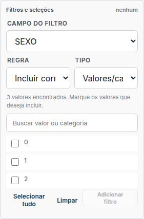

**Filtros e seleções** aceita:

- **valores exatos** — escolha na lista, com busca;
- **faixa numérica** — com limites inclusivos ou exclusivos, escolhidos por
  você, não presumidos;
- **regras cruzadas** — condições que envolvem mais de um campo, com ação de
  incluir ou excluir.

Todo filtro ativo aparece listado, com um ✕ para remover. Nenhum filtro fica
aplicado sem estar visível nessa lista.

---

## 6. Limpeza assistida e qualidade

**Limpeza assistida** examina os dados e relata o que encontrou: campos com
ausência alta, códigos fora de domínio, datas impossíveis. Ele **relata**; a
decisão de agir é sua, e cada ação vira uma etapa visível.

**Combinações raras** encontra cruzamentos de valores que aparecem pouquíssimas
vezes — frequentemente erro de digitação, às vezes achado real.

---

## 7. Transformar dados

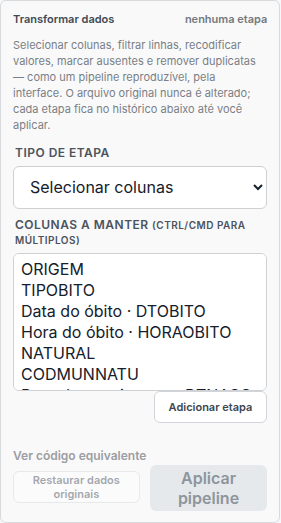

**Transformar dados** é um pipeline no estilo dplyr/pandas, aplicado sobre os
registros antes da tabulação. Onze verbos:

| Verbo | Para quê |
| --- | --- |
| selecionar colunas | ficar só com o que interessa |
| filtrar linhas | recortar registros |
| recodificar | trocar valores por outros |
| marcar ausentes | declarar que certo código significa "sem informação" |
| remover duplicados | por chave escolhida |
| campo calculado | criar coluna com fórmula (seção 8) |
| converter tipo | texto ↔ número ↔ data |
| partes de data | extrair ano, mês, e **semana epidemiológica** (padrão MMWR/MS) |
| padronizar texto/código | normalizar acento, caixa, e **código IBGE de município** |
| agrupar e resumir | colapsar em uma linha por chave, com N e somas |
| empilhar / juntar | `bind_rows` e `join` com outra base |

**O arquivo original nunca é alterado.** O pipeline é uma receita aplicada na
leitura; fechar e reabrir sem a receita devolve o dado cru.

**Ver código equivalente** mostra o pipeline escrito em **dplyr** e em
**pandas**. Ele só exibe — não executa nada. Serve para levar a análise para o
R ou o Python, ou para conferir se o que você montou é o que você queria.

---

## 8. Fórmulas estilo Excel

Campos calculados e colunas derivadas aceitam fórmulas com **57 funções**:
aritmética, texto, data, lógica (`IF`, `IFERROR`), estatística básica, e
funções de análise (`RATE`, `PERCENT`, `RATIO`, `CHANGE`, `PCTCHANGE`, `LAG`,
`ZSCORE`). Vários nomes existem em português e em inglês (`ARRED`/`ROUND`,
`CONT`/`COUNT`, `E`/`AND`), então a fórmula aceita como você estiver
acostumado a escrever.

**Funções disponíveis** lista todas, com descrição — e a lista é gerada pelo
próprio motor, então ela nunca fica desatualizada em relação ao que funciona.

Duas coisas importantes:

- O conjunto de funções é **fechado**. Um nome que não está na lista é recusado
  na leitura da fórmula, não no meio do cálculo. Isso é uma fronteira de
  segurança, não uma limitação a contornar.
- `IFERROR` é o único lugar onde um erro é engolido, e só porque você pediu por
  escrito.

---

## 9. As abas de resultado

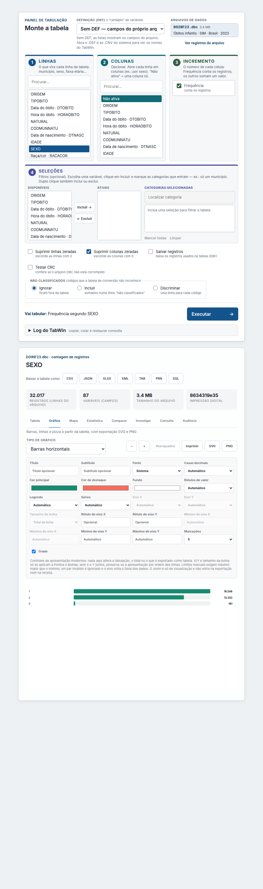

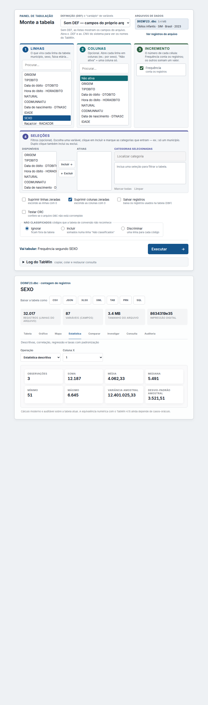

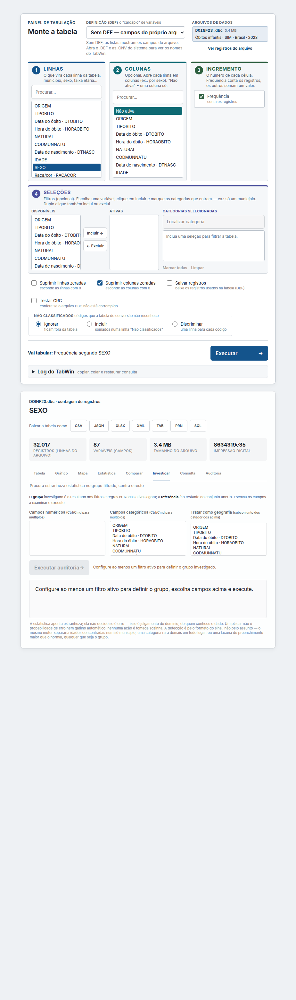

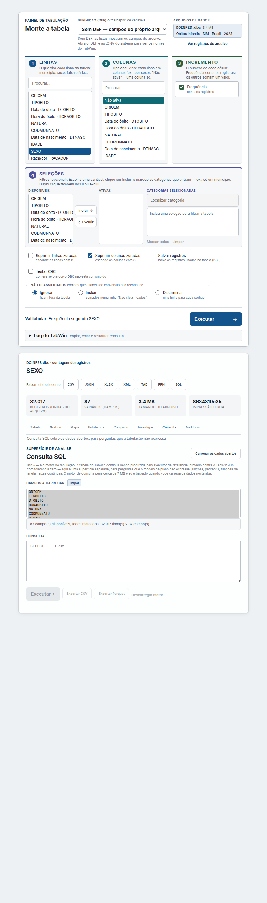

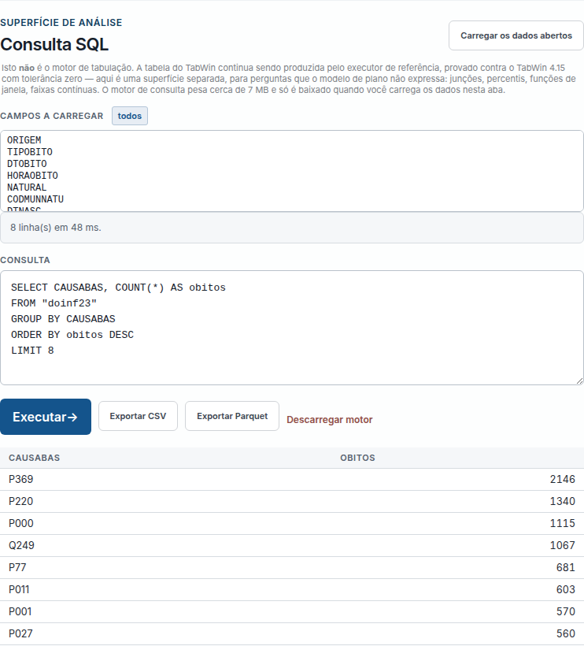

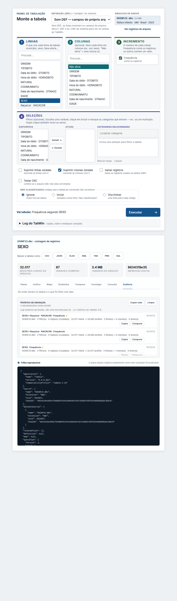

**Tabela** — o resultado. Aqui também ficam as operações pós-tabela: totais,
percentuais, renomear e mover colunas, ordenar, casas decimais, título e
rodapé.

Para quem vem do TabWin, os atalhos de sempre funcionam (conferidos com o
manual do curso TabWin de fev/2011):

| No TabWin | No TabSis |
| --- | --- |
| Clicar no título da coluna | Ordena do maior para o menor; outro clique, do menor para o maior. |
| Operações → Somar / Mínimo / Máximo | Operações → "Somar várias colunas", "Menor…", "Maior…" (Ctrl+clique para marcar). |
| Operações → Multiplicar / Dividir | Total **pré-calculado**: a conta feita nos totais, não a soma das linhas. |
| Operações → Calcular indicador | Mesmo nome; escala "por 1" a "por 1.000.000" e Casas decimais. |
| Operações → Nova coluna `Custo Médio=c2/c1` | Nova coluna por expressão aceita igual; `…*100,00` mostra 2 casas. |
| Operações → Seqüência depois de ordenar | Numera as linhas pela ordem atual: as "n" maiores categorias. |
| Operações → Recalcula total, Quadro → Tipo de total | Editar linhas e colunas → Tipo de total / Recalcular total. |
| Quadro → Decimais | Casas decimais da coluna (Editar) ou da tabela inteira (Quadro). |
| Quadro → Suprimir/agregar linhas | Mesmo critério (igual, maior, menor, diferente) e linha "Outras". |
| Quadro → Fixar comprimento da chave | Quadro → Comprimento da chave, usado ao Incluir tabela. |
| Editar → Editar arquivo DEF ou CNV → Gera DEF | Metadados → **Gerar DEF**: marque os campos; baixe ou use no painel. |
| … → Gera CNV / Numera CNV | Editor de CNV → **Gerar do campo** / **Numerar**. |
| Estatísticas → Regressão linear (coluna estimada) | Estatística → Regressão → "Inserir coluna com os valores estimados". |
| Estatísticas → Histograma → Igual freqüência | Estatística → Histograma → Tipo de classe. |
| Arquivo → Salvar como (Tabela do TabWin, Texto, SQL) | Botões **TAB**, **PRN** e **SQL** no topo da tabela. O `.TAB` abre no TabWin. |
| Editar → Colar | "Análises e tabelas salvas" → **Colar tabela**. |
| Botão direito → nota técnica | Botão direito na linha, coluna ou célula. |

Valores negativos aparecem em vermelho, como no TabWin.

**Gráfico** — barras, linhas, pizza e outros, com editor de cores, fontes e
rótulos. Exporta SVG e PNG.

**Mapa** — mapas temáticos a partir de `.MAP` legado ou GeoJSON, com classes de
corte, legenda, seleção espacial e fluxos origem–destino.

**Estatística** — em **Operação** você escolhe: estatística descritiva,
correlação de Pearson, regressão linear simples, histograma (com gaussiana
ajustada quando cabe, e dizendo quando **não** cabe), e **Taxas e
padronização**.

É em *Taxas e padronização* que mora a epidemiologia: taxa bruta com intervalo
de confiança (Byar), padronização **direta** (população-padrão) e **indireta**
(SMR, taxas de referência), e razão de taxas padronizadas.

**Comparar** — alinha duas tabelas por chave e mostra as diferenças. Reporta o
que não casou dos dois lados. **Nunca inventa zero** para uma chave ausente, e
divisão por ausente dá "—", não `0`.

**Investigar** — auditoria estatística de um grupo contra o resto. O **grupo** é
o resultado dos filtros e regras cruzadas ativos naquele momento; a
**referência** é o restante do conjunto aberto. Você escolhe os campos
numéricos e categóricos a examinar (e quais tratar como geografia) e executa.

A detecção é **pela forma do sinal, não pelo assunto**: o mesmo motor separa
idades concentradas num só município, uma categoria rara demais em todo lugar,
ou uma lacuna de preenchimento maior que o normal — seja qual for o grupo.

Duas coisas que a tela também diz, e que valem repetir: o placar **não é
probabilidade de erro** nem gatilho automático, e nenhuma ação é tomada
sozinha. A estatística aponta estranheza; decidir se é erro é julgamento de
quem conhece o dado.

> **População padrão não vem embutida.** Isso é escolha, não esquecimento: o
> programa não vai fabricar números de referência por você. Você fornece a sua
> população padrão como uma base e junta com `join`. Assim fica registrado
> *qual* padrão você usou — o que muda o resultado e precisa constar do método.

**Auditoria** — a procedência: arquivos abertos, hashes SHA-256, origem, hora
de obtenção, e as etapas aplicadas. É o que você cola no método de um artigo.
Traz também o histórico de tabulações da sessão, com comparação entre duas
delas. Esse log é moderno, da sessão — **não** é uma reconstrução do `.LST`
histórico do TabWin 4.15.

---

## 10. Salvar e reabrir

| Formato | O que guarda |
| --- | --- |
| `.twrecipe` (**Salvar análise**) | o plano inteiro: variáveis, filtros, conversões, **e o pipeline de transformação** |
| `.twtable` (**Salvar tabela**) | o resultado calculado, para reabrir ou comparar |
| `.DBF` (**Salvar seleção em DBF**) | os registros que passaram nos filtros |
| CSV / JSON / XLSX / XML | exportação do resultado |
| **Microdatasus filtrado CSV** | os registros aceitos, no formato que o pacote `microdatasus` do R espera |
| **Extrair DBF original** | o DBF de dentro do DBC, sem alteração |
| **Pacote para o Lab** | a tabela mais um `PROVENIENCIA.json` (origem, hash das fontes, filtros e transformações), para analisar no Tabwin Lab |

A receita carrega o pipeline junto. Sem isso ela reconstruiria uma tabela
diferente enquanto afirma fidelidade à fonte — e uma receita que mente sobre
isso é pior que nenhuma receita.

### Levar para o Tabwin Lab

O **Pacote para o Lab** é um `.zip` com `dados.csv` e `PROVENIENCIA.json`.
Existe em vez de um CSV solto por um motivo prático: um CSV sozinho é número
sem origem — meses depois ninguém sabe qual arquivo do DATASUS o gerou, que
filtros estavam ativos, nem se a coluna já vinha recodificada. A procedência
responde isso por escrito, com o hash de cada fonte, para a análise poder ser
citada.

Célula vazia significa **ausente**. Nenhum zero é fabricado para preencher
lacuna — nem na exportação, nem na leitura do outro lado.

### Abrir um `.TAB` do TabWin 4.15

**Abrir tabela** aceita tanto o `.twtable` deste aplicativo quanto um `.TAB`
salvo pelo TabWin 4.15. A leitura foi verificada contra uma captura real do
programa (golden G023).

O `.TAB` abre **somente para leitura**, e a razão importa: ele traz o
*resultado* que o TabWin calculou, não os microdados. Dá para ver, formatar e
exportar a tabela — mas **Salvar análise** fica desligado, porque uma receita
que não reconstrói nada seria uma promessa falsa. A procedência que o próprio
arquivo declara (DEF, arquivos, seleções) aparece acima da tabela, sem
tradução: um código como `Não_Classificados=0` continua um código, porque uma
amostra não basta para mapeá-lo.

Se alguma célula estiver ilegível, o arquivo é **recusado** dizendo qual —
preencher com zero inventaria um número que ninguém observou.

**Escrever `.TAB` continua fora de escopo**, até haver artefatos reais
suficientes para provar quais campos são estáveis.

---

## 10.1 Onde ficam as ações secundárias

Para a barra lateral não ser uma pilha de botões de peso igual, as ações que
não fazem parte do fluxo principal ficam em seções recolhíveis:

- **Exportar o arquivo** — extrair o DBF original, salvar a seleção em DBF,
  CSV para o `microdatasus`;
- **Metadados** — Editor de CNV e Inspetor de DEF;
- **Análises e tabelas salvas** — abrir e salvar receitas e tabelas.

Nada foi removido; tudo está a um clique no cabeçalho da seção.

---

## 11. Editor de CNV e Inspetor de DEF

**Editor de CNV** cria e edita conversões com validação: categoria sem regra,
sequência duplicada, alvo de subtotal inexistente e faixa sem limite superior
são erros apontados com a linha de origem, não falhas silenciosas. Grava em
Windows-1252, como o formato original exige.

**Inspetor de DEF** mostra o que um `.DEF` declara: opções de linha e coluna,
incrementos, seleções, e quais conversões cada opção usa.

---

## 12. O que o programa promete e o que não promete

O projeto separa três coisas, e a interface também:

- **Compatível** — o comportamento foi verificado contra o **TabWin 4.15 real**,
  com arquivo real, resultado capturado do programa original e comparação com
  tolerância zero. Hoje cobrem SIH, SIA, SIM, SINASC, SINAN e CNES: os goldens
  do projeto mais as tabelas salvas pelo próprio TabWin com os DEF e CNV
  oficiais (`docs/reverse-engineering/`, RE-002 a RE-004).
- **Moderno** — funcionalidade nova, que o TabWin 4.15 não tinha. Não afirma
  equivalência com nada.
- **Não verificado** — existe, funciona, mas ninguém conferiu contra o programa
  original.

Nada vira "compatível" por suposição. Se você depende de equivalência exata com
o TabWin para um uso específico, vale conferir em qual dessas três categorias
ele cai.

**Regras que valem em todo lugar do programa:**

1. **Zero nunca é fabricado.** Denominador zero, célula ilegível ou valor
   ausente aparecem como "—", nunca como `0`. Zero é uma afirmação sobre o
   mundo, e o programa não faz afirmações que você não fez.
2. **Nada é amostrado em silêncio.** Se algo foi limitado, truncado ou deixado
   de fora, está escrito na tela.
3. **Um padrão pode existir; um padrão invisível não.**

---

## 13. Problemas comuns

**"arquivo expandido grande demais"** — um arquivo dentro do pacote não cabe na
memória da aba. O resto do pacote abre normalmente; use **Baixar arquivo** para
salvar aquele item e usá-lo fora do navegador.

**Rótulo aparecendo como código** — falta a CNV correspondente, ou ela ficou de
fora do pacote. Verifique em **Definição (DEF) ativa** qual DEF está mandando,
e se as conversões dele foram abertas.

**Números diferentes do TabNet** — o TabNet aplica filtros próprios (por
exemplo, só casos confirmados) que não estão no microdado cru. Compare o que
cada um está contando antes de concluir que há divergência.

**A tabela veio vazia** — geralmente é filtro. A contagem de registros lidos ×
aceitos, logo acima da tabela, mostra quantos sobreviveram aos filtros.

**Aba travando com arquivo grande** — use os filtros para reduzir antes de
tabular, ou trabalhe por período.

---

## 14. Onde procurar mais

- **Auditoria** — a procedência completa da análise que está na tela.
- `docs/testing/` — os protocolos de captura e o corpus de goldens.
- `docs/legacy/TABWIN_415_FEATURE_INVENTORY.md` — o inventário do programa
  original, que define o alvo de compatibilidade.
- **Quem decodifica o `.DBC`** é o pacote
  [`@precisa-saude/datasus-dbc`](https://www.npmjs.com/package/@precisa-saude/datasus-dbc).
  Se você precisar ler DBC fora daqui — num script em Node, num pipeline —, é
  ele que você quer, e não este programa.
